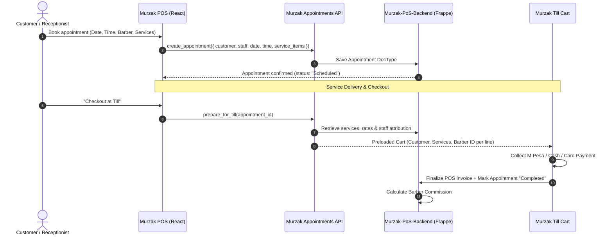
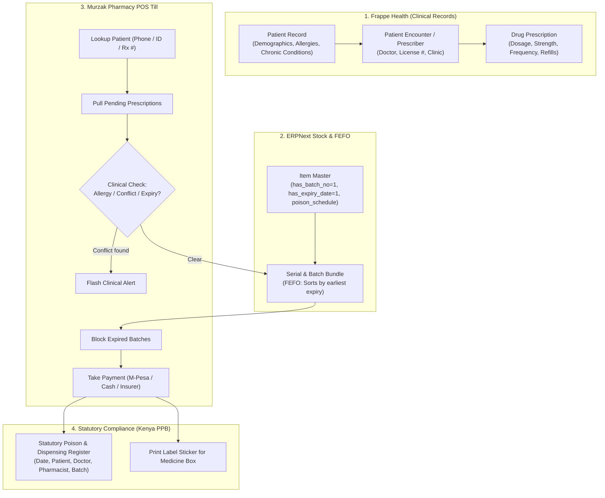

# Native Frappe Appointments & Frappe Health Integration Specification

This specification documents the end-to-end architecture and implementation guide for two major vertical solutions in **Murzak POS**:
1. **Native Frappe Appointments** for the **Salon & Barber** (and Service) industry.
2. **Frappe Health (`healthcare`)** integration for the **Pharmacy** POS industry.

---

## Part 1: Native Frappe Appointments (Salon / Barber & Services)

### 1. Architectural Overview
Instead of maintaining external appointment containers (e.g. PHP/MySQL or Cal.com clusters), Murzak POS leverages **Frappe's native Document framework** on `Murzak-PoS-Backend`.



### 2. Frappe DocType Schema (`Murzak-PoS-Backend`)

#### `POS Appointment` DocType
| Field | Type | Options / Reference | Description |
| :--- | :--- | :--- | :--- |
| `name` | Data (Series) | `APT-.YYYY.-.#####` | Unique appointment ID |
| `company` | Link | `Company` | Shop / Tenant |
| `customer` | Link | `Customer` | Optional registered customer |
| `customer_name` | Data | | Client full name |
| `customer_phone` | Data | | Phone number (Kenyan normalisation: `2547XXXXXXXX`) |
| `staff` | Link | `User` / `Employee` | Assigned Barber / Stylist / Chair |
| `appointment_date`| Date | | Scheduled service date |
| `appointment_time`| Time | | Scheduled start time |
| `duration_minutes`| Int | Default: `30` | Slot duration (15, 30, 45, 60, 90 min) |
| `status` | Select | `Scheduled`, `In-Progress`, `Completed`, `Cancelled` | Operational workflow stage |
| `service_items` | Table | `POS Appointment Service Item` | Child table of booked services |
| `pos_invoice` | Link | `POS Invoice` | Created upon payment at till |
| `notes` | Small Text | | Customer preferences (e.g., skin fade, beard balm) |

#### `POS Appointment Service Item` (Child DocType)
* `item_code`: Link to `Item` (must be `is_service = 1`)
* `item_name`: Data
* `rate`: Currency
* `staff`: Link to `Employee` / `User` (per-service line stylist attribution)

---

### 3. API Contract (`murzak_pos.api.appointment_api`)

#### 1. `list_appointments`
* **Method:** `GET`
* **Params:** `company`, `date` (YYYY-MM-DD), `staff` (optional), `status` (optional)
* **Response:**
  ```json
  {
    "success": true,
    "data": [
      {
        "name": "APT-2026-00012",
        "customer_name": "Kevin Mwangi",
        "customer_phone": "254712345678",
        "staff": "Barber Dennis",
        "appointment_time": "10:30:00",
        "duration_minutes": 45,
        "status": "Scheduled",
        "services": [
          { "item_code": "HAIRCUT-01", "item_name": "Executive Haircut", "rate": 800 },
          { "item_code": "BEARD-02", "item_name": "Beard Grooming & Hot Towel", "rate": 500 }
        ]
      }
    ]
  }
  ```

#### 2. `create_appointment`
* **Method:** `POST`
* **Payload:** `{ company, customer, customer_name, customer_phone, staff, appointment_date, appointment_time, duration_minutes, service_items, notes }`

#### 3. `prepare_for_till`
* **Method:** `GET`
* **Params:** `appointment_id`
* **Returns:** Pre-formatted till cart payload with item codes, quantities, rates, customer reference, and staff attribution per line.

---

## Part 2: Frappe Health Integration for Pharmacy Industry POS

### 1. Why Frappe Health (`frappe/healthcare`)?
Frappe Health is the official open-source healthcare domain for Frappe/ERPNext. For pharmacies, running Frappe Health provides clinical rigor, patient tracking, batch compliance, and statutory alignment without reinventing medical logic.



---

### 2. Core Frappe Health DocTypes Utilized

#### 1. `Patient` $\leftrightarrow$ `Customer` Integration
* In Frappe Health, every `Patient` links to a standard ERPNext `Customer`.
* When a pharmacy client registers or pays at Murzak POS, the system queries `murzak_pos.api.pharmacy_health_api.lookup_patient`.
* Attributes accessed:
  * `patient_name`, `mobile`, `email`, `blood_group`
  * `allergies` (Table of documented drug allergies, e.g., Penicillin, Sulfa)
  * `customer` (Linked for loyalty points, store credit limit, and receivables)

#### 2. `Drug Prescription` (Child DocType of `Patient Encounter`)
When a prescription is loaded at the till:
* `drug_code`: Item code for the medication.
* `dosage`: Strength and dose (e.g. *500mg - 1 capsule*).
* `period`: Duration (e.g. *7 days*).
* `interval_type`: Schedule (e.g. *Three times daily after meals*).
* `is_dispensed`: Automatically flipped to `1` upon completed POS sale.

#### 3. FEFO (First-Expiry, First-Out) & Batch Control
* Medications in Murzak POS are configured with:
  * `has_batch_no = 1`
  * `has_expiry_date = 1`
  * `retain_sample = 0`
* **Automated FEFO Selection:** When a medicine is added to the cart, the backend automatically queries available batches from the pharmacy warehouse ordered by `expiry_date ASC`.
* **Zero-Expired Dispensing Guarantee:** If the earliest batch has an `expiry_date <= today`, the till strictly forbids adding it to the cart and notifies the cashier to pull the expired batch from the shelf for quarantine.

#### 4. Controlled Substances & Statutory Poison Register (Kenya PPB Compliance)
Under Kenya's Pharmacy and Poisons Board (PPB) Act (Cap 244):
* **Part I Poisons** and **Prescription-Only Medicines (POM)** require recording:
  1. Date of sale.
  2. Patient name, age, address, and National ID/Passport.
  3. Prescriber name, qualifications, and Medical Council registration number (KMPDC).
  4. Medication name, strength, batch number, and quantity dispensed.
  5. Dispensing pharmacist's name and registration number.
* Murzak POS records this automatically upon sale finalization via `record_dispense`, providing one-click exportable **Statutory Dispensing Registers** for regulatory inspections.

---

### 3. API Contract (`murzak_pos.api.pharmacy_health_api`)

#### 1. `lookup_patient`
* **Method:** `GET`
* **Params:** `term` (Phone, National ID, or Patient Name), `company`
* **Response:**
  ```json
  {
    "success": true,
    "data": {
      "name": "PAT-2026-0034",
      "patient_name": "Faith Muthoni",
      "phone": "254722000111",
      "customer": "CUST-00234",
      "allergies": ["Penicillin", "Aspirin"],
      "chronic_conditions": ["Hypertension"]
    }
  }
  ```

#### 2. `get_prescriptions`
* **Method:** `GET`
* **Params:** `patient_id` or `phone`, `status` ("Pending" | "Completed")
* **Response:**
  ```json
  {
    "success": true,
    "data": [
      {
        "prescription_id": "PRE-2026-00089",
        "practitioner": "Dr. Peter Kamau",
        "practitioner_reg": "A-48192",
        "encounter_date": "2026-10-20",
        "drug_code": "AMOX-CLAV-625",
        "drug_name": "Augmentin (Amoxicillin/Clavulanate) 625mg",
        "dosage": "1 tablet twice daily after meals",
        "qty": 14,
        "is_controlled": 0,
        "is_prescription_only": 1
      }
    ]
  }
  ```

#### 3. `get_item_batches`
* **Method:** `GET`
* **Params:** `item_code`, `warehouse`
* **Response:** Batches ordered by expiry date with stock quantities and expired flags.

#### 4. `validate_clinical_safety`
* **Method:** `POST`
* **Payload:** `{ patient_id, cart_items }`
* **Response:** Returns safety status, detected allergy conflicts, and drug-drug interactions.

#### 5. `record_dispense`
* **Method:** `POST`
* **Payload:** `{ company, invoice_id, patient_id, prescriber_name, prescriber_reg_no, dispensing_pharmacist, items }`
* **Action:** Logs entry into statutory register and marks prescription child rows as dispensed.

---

## Part 3: Frontend Implementation Files Added to Murzak POS

1. **[`src/api/appointmentsApi.js`](file:///c:/Users/joesy/Documents/antigravity/focused-babbage/repo/src/api/appointmentsApi.js)**
   * Complete client for appointment listing, creation, status progression, and 1-click preparation for till checkout.
2. **[`src/api/appointmentsApi.test.js`](file:///c:/Users/joesy/Documents/antigravity/focused-babbage/repo/src/api/appointmentsApi.test.js)**
   * 100% passing test coverage verifying all endpoints, payloads, and parameter handling.
3. **[`src/api/pharmacyHealthApi.js`](file:///c:/Users/joesy/Documents/antigravity/focused-babbage/repo/src/api/pharmacyHealthApi.js)**
   * Complete client for Frappe Health patient lookup, prescription loading, FEFO batch querying, clinical safety checks, and statutory dispensing logging.
4. **[`src/api/pharmacyHealthApi.test.js`](file:///c:/Users/joesy/Documents/antigravity/focused-babbage/repo/src/api/pharmacyHealthApi.test.js)**
   * 100% passing test coverage verifying patient lookup, allergy checks, batch resolution, and statutory register logging.
